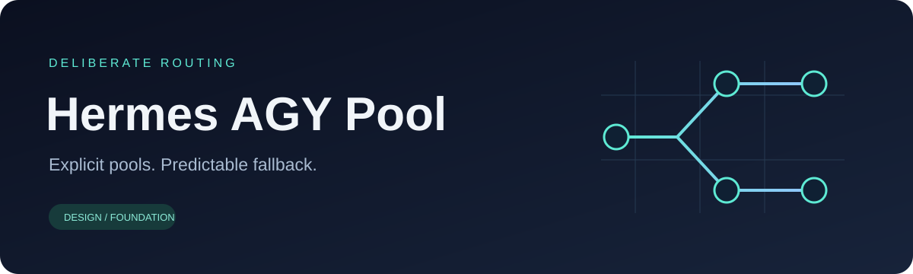
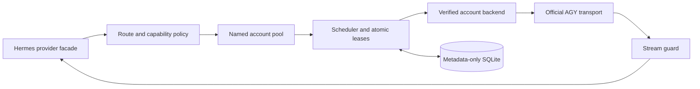

<div align="center">



# Hermes AGY Pool

**One routing layer. Explicit pools. Predictable fallback.**

[](docs/ROADMAP.md)
[](LICENSE)
[](https://github.com/NVMau/hermes-agy-pool/actions/workflows/docs.yml)

A lightweight, backend-independent routing core for Hermes Agent with an optional local CLIProxyAPI connectivity probe and Hermes custom-provider configuration output. An official AGY transport adapter remains planned.

[Architecture](docs/ARCHITECTURE.md) · [Roadmap](docs/ROADMAP.md) · [Research](docs/RESEARCH.md) · [Contributing](CONTRIBUTING.md)

</div>

---

> **Offline coordination core plus opt-in local proxy connector — not an installable Hermes provider.** The proxy probe makes a real local HTTP request; the pool itself remains offline. Strict JSON validation, conditional plans, in-memory runtime policy, atomic SQLite reservations and a bounded metadata scheduler are implemented. Identity verification, live worker execution, live account rotation and inference are not implemented. See [scheduler contract and evidence](docs/SCHEDULER.md) and the [bounded synchronous lifecycle](docs/LIFECYCLE.md) (injected stream fixtures and direct-child cancellation evidence only).

## Why this exists

Multi-account routing should not require bringing an entire API gateway into an agent. Hermes AGY Pool aims to keep the useful coordination primitives — account selection, model-aware cooldowns, bounded workers and explicit fallback — without a web server, dashboard, Redis or protocol translation stack.

The goal is a small control layer with clear behavior, not a claim to outperform CLIProxyAPI.

## Planned capabilities

| Primitive | Intended behavior |
| --- | --- |
| **Named pools** | Separate interactive and background traffic; no implicit cross-pool routing |
| **Account failover** | Try eligible accounts for the same model before considering another model |
| **Model fallback** | Ordered, opt-in alternatives that preserve required tools, vision and schema capabilities |
| **Scoped cooldowns** | Distinguish account auth failures from model entitlement, quota and capacity failures |
| **Session affinity** | Keep healthy sessions on their existing account and worker |
| **Bounded concurrency** | Shared account limits, global worker cap and deadline-aware queueing |
| **Stream integrity** | Never replay automatically after visible text, reasoning or a tool-call fragment |
| **Explainable decisions** | Redacted routing diagnostics with requested and resolved model IDs |

## The shape of the system



**Pool engine ≠ credential backend.** A cloud proxy can manage multiple credentials successfully while the local CLI still resolves a single OS-level login. Backends must prove which identity they use; changing HOME alone is not identity isolation.

See [the identity boundary ADR](docs/adr/0001-identity-boundary.md).

## Policy preview

This route fragment illustrates the validated schema; use the full example for CLI input:

```json
{
  "route": "interactive/quality",
  "group": "interactive",
  "models": ["claude-sonnet-4-6", "gemini-3.1-pro"],
  "fallback_on": ["unsupported_model"],
  "required_capabilities": ["tools"]
}
```

The first choice stays the first choice. The router tries another eligible account for that model first. It changes model only when the configured policy allows it. Model identifiers here are illustrative, not entitlement guarantees.

[Full policy example →](examples/pools.json)

## Non-goals for the first release

- No HTTP proxy server or management dashboard.
- No credential harvesting, host-token copying or undocumented OAuth impersonation.
- No silent model downgrade or arbitrary cross-pool fallback.
- No unlimited subprocess spawning on contention.
- No claim of production readiness before real identity and lifecycle tests pass.

## Implemented runtime policy

A deterministic, in-memory state machine executes the routing policy without live inference or network dependencies:

- **Typed failures & conservative cooldowns**: `Failure(kind, scope, retry_after_s)` distinguishes `account` from `model` scope. Unknown scopes fail safe and quarantine the whole account. Authentication failures trigger quarantine until explicit administrative reset. Retry hints from upstream are honored.
- **Verified capability snapshot**: `Catalog` and `ModelSupport` map attested identity verification and capabilities (`tools`, `vision`, `schema`) to canonical models, resolving aliases cleanly without speculative inference.
- **Same-model failover & explicit fallback**: `RequestRouter` tries unvisited verified eligible accounts for the primary model before testing configured `fallback_on` conditions to advance to subsequent models. Group boundaries are strictly preserved.
- **Stream protection**: `visible(attempt, fragment)` marks output emission (text, reasoning, tool calls). Any subsequent failure terminates immediately with `stop_reason='visible_output'`; partial completions are never replayed.
- **Bounded attempts & deadlines**: Bounded by `limits.max_attempts` and absolute request deadlines; terminal failures (`unknown`, `invalid_request`, `context`) halt without rotation.

## Implemented reservation scheduler

- Atomic account/global reservation caps across groups and cooperating processes on one SQLite file, including idle reservations.
- Opaque owner-scoped idempotent release; unknown/stale owners remain reserved, never heartbeat-reclaimed.
- Persistent eligible-account sticky affinity and round-robin; a runtime reservation bridge does not spend routing attempts for full capacity.
- A caller-driven, bounded in-memory queue with deadlines, cancellation and context-managed cleanup. Real multiprocessing tests verify metadata contention, not a live AGY process pool.

[Full API, lifecycle limits and TDD evidence](docs/SCHEDULER.md). No live transport/auth implementation is included.

## Local proxy connector

An opt-in local OpenAI-compatible `/v1/models` probe and Hermes custom-provider configuration fragment are available; the proxy independently chooses accounts and the offline pool does not control requests. [Configuration, Windows PowerShell usage and limitations →](docs/PROXY.md).

## Development status

The current deliverable is a standard-library-only Python core (Python 3.11+). Run from the repository root; no package installation or Hermes configuration changes are needed.

```sh
python -m unittest discover -s tests -v
python -m agy_pool validate examples/pools.json
python -m agy_pool plan examples/pools.json interactive/quality --dry-run
```

`validate` checks syntax, schema and references, not credentials or entitlement. `plan` requires `--dry-run` and emits JSON labeled `simulation`. See [the implemented contract](docs/CONFIG.md).

The plan lists enabled account aliases in group order for each model, with explicit failure gates for later models. It is a conditional policy tree, **not an executable attempt list**: the planner itself does not verify capabilities/identities, enforce limits or execute sticky/round-robin selection. The separate runtime reservation scheduler does enforce its metadata limits. There is no fake backend.

Remaining integration gates:

1. Prove an account identity boundary for the selected backend.
2. Extend metadata policy/scheduling into a verified worker lifecycle without weakening reservation caps.
3. Integrate bounded workers and streaming lifecycle.
4. Validate Hermes sync, async and auxiliary paths.
5. Run approved live tests before publishing an installable release.

Read [CONTRIBUTING.md](CONTRIBUTING.md) before opening a PR. Runtime CI is configured for Windows/Linux and Python 3.11/3.14, running unit tests and CLI smoke commands. Documentation CI checks repository files. Neither proves live inference or identity isolation.

## Inspiration and attribution

- [CLIProxyAPI](https://github.com/router-for-me/CLIProxyAPI): selection, cooldown, retry and stream-bootstrap design patterns.
- [hermes-antigravity-oauth](https://github.com/neerazz/hermes-antigravity-oauth): official AGY process integration reference.
- [Hermes Agent](https://github.com/NousResearch/hermes-agent): provider plugin host.

Independent community project. Not affiliated with or endorsed by Google, Nous Research or the upstream projects. Use authorized accounts and respect provider terms and quotas.

## License

[MIT](LICENSE). See [THIRD_PARTY_NOTICES.md](THIRD_PARTY_NOTICES.md) for research provenance and future code-reuse requirements.
