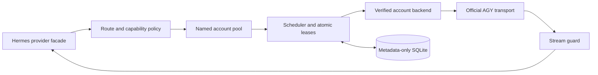

<div align="center">


# Hermes AGY Pool

**One routing layer. Explicit pools. Predictable fallback.**

[](docs/ROADMAP.md)
[](LICENSE)
[](https://github.com/NVMau/hermes-agy-pool/actions/workflows/docs.yml)

A lightweight, backend-independent routing design for Hermes Agent — inspired by CLIProxyAPI, starting with an official AGY transport adapter.

[Architecture](docs/ARCHITECTURE.md) · [Roadmap](docs/ROADMAP.md) · [Research](docs/RESEARCH.md) · [Contributing](CONTRIBUTING.md)

</div>

---

> **Design-stage project — not an installable provider yet.** This repository contains the architecture, policy example, engineering contracts and implementation roadmap. Account rotation, inference and model fallback are planned, not shipped.

## Why this exists

Multi-account routing should not require bringing an entire API gateway into an agent. Hermes AGY Pool aims to keep the useful coordination primitives — account selection, model-aware cooldowns, bounded workers and explicit fallback — without a web server, dashboard, Redis or protocol translation stack.

The goal is a small control layer with clear behavior, not a claim to outperform CLIProxyAPI.

## Planned capabilities

| Primitive | Intended behavior |
| --- | --- |
| **Named pools** | Separate interactive and background traffic; no implicit cross-pool routing |
| **Account failover** | Try eligible accounts for the same model before considering another model |
| **Model fallback** | Ordered, opt-in alternatives that preserve required tools, vision and schema capabilities |
| **Scoped cooldowns** | Distinguish account auth failures from model entitlement, quota and capacity failures |
| **Session affinity** | Keep healthy sessions on their existing account and worker |
| **Bounded concurrency** | Shared account limits, global worker cap and deadline-aware queueing |
| **Stream integrity** | Never replay automatically after visible text, reasoning or a tool-call fragment |
| **Explainable decisions** | Redacted routing diagnostics with requested and resolved model IDs |

## The shape of the system



**Pool engine ≠ credential backend.** A cloud proxy can manage multiple credentials successfully while the local CLI still resolves a single OS-level login. Backends must prove which identity they use; changing HOME alone is not identity isolation.

See [the identity boundary ADR](docs/adr/0001-identity-boundary.md).

## Policy preview

This is a **proposed schema**, not an executable configuration today:

```json
{
  "route": "interactive/quality",
  "group": "interactive",
  "models": ["claude-sonnet-4-6", "gemini-3.1-pro"],
  "fallback_on": ["unsupported_model"],
  "required_capabilities": ["tools"]
}
```

The first choice stays the first choice. The router tries another eligible account for that model first. It changes model only when the configured policy allows it. Model identifiers here are illustrative, not entitlement guarantees.

[Full policy example →](examples/pools.json)

## Non-goals for the first release

- No HTTP proxy server or management dashboard.
- No credential harvesting, host-token copying or undocumented OAuth impersonation.
- No silent model downgrade or arbitrary cross-pool fallback.
- No unlimited subprocess spawning on contention.
- No claim of production readiness before real identity and lifecycle tests pass.

## Development status

The current deliverable is an implementation-ready project structure and a gated roadmap. There is deliberately no fake provider entrypoint or install command.

1. Prove an account identity boundary for the selected backend.
2. Implement pure policy and scheduling behavior using TDD.
3. Integrate bounded workers and streaming lifecycle.
4. Validate Hermes sync, async and auxiliary paths.
5. Run approved live tests before publishing an installable release.

Read [CONTRIBUTING.md](CONTRIBUTING.md) before opening a PR. Documentation CI validates the JSON example and required repository files; it does **not** test an inference implementation.

## Inspiration and attribution

- [CLIProxyAPI](https://github.com/router-for-me/CLIProxyAPI): selection, cooldown, retry and stream-bootstrap design patterns.
- [hermes-antigravity-oauth](https://github.com/neerazz/hermes-antigravity-oauth): official AGY process integration reference.
- [Hermes Agent](https://github.com/NousResearch/hermes-agent): provider plugin host.

Independent community project. Not affiliated with or endorsed by Google, Nous Research or the upstream projects. Use authorized accounts and respect provider terms and quotas.

## License

[MIT](LICENSE). See [THIRD_PARTY_NOTICES.md](THIRD_PARTY_NOTICES.md) for research provenance and future code-reuse requirements.
